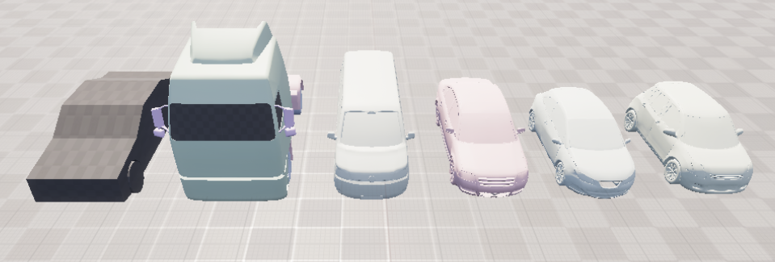
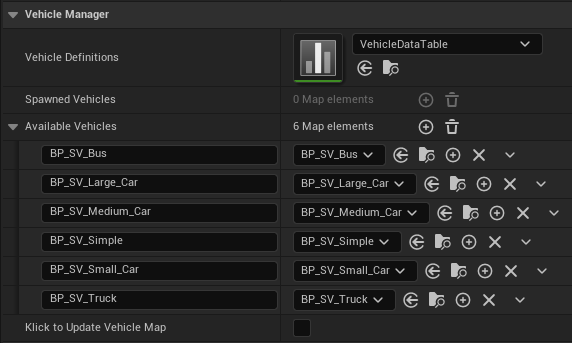
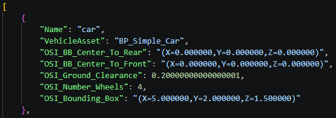

# GEMSTAR UE_Vehicle_Feature

[](https://www.dlr.de/en/ts/about-us/the-institute-of-transportation-systems)

3D vehicle models for the use in GEMSTAR. Maps names from scenario to asset, spawns and moves them accordingly to position updates.



## Input
- Vehicle Data

# Getting started

First clone the GEMSTAR Interfaces plugin inside Plugins and the ue_visualizer_feature inside Plugins/GameFeatures.

Add the plugin to your Unreal project:
```sh
mkdir Plugins/GameFeatures
cd Plugins/GameFeatures

git clone https://github.com/DLR-TS/ue_vehicle_feature.git
```
or:
```sh
git submodule add https://github.com/DLR-TS/ue_vehicle_feature.git
```

# Configuration

The Blueprint BP_VehicleManager contains the mappings from scenario vehicle name vehicle asset name.



**Spawned Vehicles** Dynamic map of vehicles during the simulation\
**Available Vehicles** Map of all available vehicles in this plugin\
**Klick to update Vehicle Map** Tick the box to update the Available Vehicles Map. Use this after the addition of new models

**Vehicle Definitions** Datatable for mapping of scenario names to asset names and additional data about vehicle types



# Test

Two testmaps are provided and located in Content/Test/
- with SUMO as a scenario player
- with esmini as a scenario player

## Data handling

This is the process when receiving new position data:

- The method VehicleDataUpdate_Implementation contains the parameters ControllerName, Name + Type or BoundingBox. Example: {esmini, Ego, VW_Golf_150PS, {x, y, z}}
  - If the name of the object is in SpawnedVehicles: Update object state
  - Else the object does not exist and needs to be spawned
    - Find vehicle type or vehicle name is found in the Vehicles Definitions datatable as name
    - Else find best matching bounding boxes defined by the Vehicle Definitions datatable
- The VehicleAsset name is then used to find the asset itself and be spawned
- The object is stored in the property pawnedVehicles of the VehicleManger actor

This approch allows for different vehicle definitons with the same asset, like different engine performances. The datatable is easy to update and the mapping allows for easy customization of more complex simulation use cases.

---------------
**Contact:** opensource-ts@dlr.de

This project uses [esmini](https://github.com/esmini/esmini), which is licensed under the
Mozilla Public License 2.0.

This project uses the Open Simulation Interface ([OSI](https://github.com/OpenSimulationInterface/open-simulation-interface)), which is licensed under the
Mozilla Public License 2.0.
